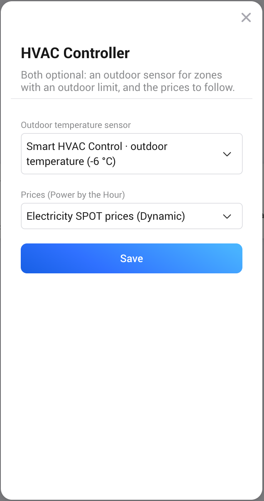

# Prices

Prices are optional. Without them only occupancy decides between comfort and eco.

The prices come from the **Power by the Hour** app (version 9 or later). It sends them to the HVAC
Controller by itself, including tomorrow's prices as soon as they are published, so no price
flows are needed.

## Set up

1. In Power by the Hour, add an energy price device for electricity, dynamic (market prices) or
   fixed (your tariff, with its time of day changes). The prices include your markups, taxes and
   VAT as set there, so the controller's costs are what you really pay.
2. When you add the HVAC Controller, choose that device under **Prices**. The list shows each
   electricity price device as its name and tariff type, for example `Electricity (Dynamic)`.
   With only one, it is already chosen.

   

3. To change it later, use **Repair** in the controller's device settings.

The currency follows the price device. 15-, 30- and 60-minute prices all work. Forecast prices
are not used: they are estimates, not prices.

If Power by the Hour is not installed, is older than version 9 or is not running, the controller
keeps the prices it already has and its **Reason** says why no new ones arrive. The controller
fires **Prices missing for tomorrow** at its check time when tomorrow's prices are not complete.

## Import prices card (deprecated)

Older setups brought the prices in with a flow and the **Import prices** card. That card and the
**Prices imported** trigger are deprecated: existing flows keep working until you choose a price
device under **Prices**, and from then on imports are ignored. Both cards will be removed in a
later major version, so choose a price device and then delete the import flow.

To choose what counts as a price peak, see [Save on price peaks](How-to#save-on-price-peaks).
