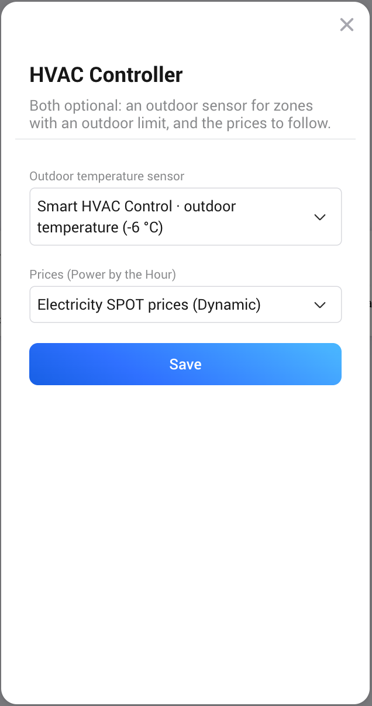

# Setup

1. Add the **Home Controller** first. You can add only one, and zones need it. It holds what all
   zones share: occupancy, season, long absence, prices and the outdoor temperature. When you add
   it, you can pick an outdoor temperature sensor and the prices to follow from Power by the Hour
   (see [Prices](Prices)). If you try to add a second one, the app points you to the existing
   controller; go on with the zones.

   

2. Add a **Heating Zone** for each room or area, and pick its devices.
3. Make flows that tell the controller who is home (see
   [Follow who is home](How-to#follow-who-is-home)).
   Optionally add a **Hot Tub** or a **Water Heater** (see
   [Hot Tub and Water Heater](Hot-Tub-and-Water-Heater)).
4. Count everything once in Homey **Energy** and **Climate**. Every device is counted in by default,
   and a device can be excluded in its device settings. The zones and the controller show the
   power and temperatures of devices Homey already counts, so keep one of them and exclude the
   other:
   - **Energy**: count either the power meters, or the zones, or the controller (the sum of the
     zones), never two of these. The same goes for a Hot Tub or Water Heater with a power meter:
     count either it or the meter.
   - **Climate**: show either the zone or its own thermostats and sensors.

If the Home Controller is removed or unavailable, the zones use its last known state for one
hour. After that they heat to comfort and ignore prices.

## Moving from Smart HVAC Control

Adaptive Home Comfort was called Smart HVAC Control, with another app id, so Homey sees it as a new
app. While both are installed (Smart HVAC Control 1.8.0 or later), adding a device starts with
**Import from Smart HVAC Control**: pick the devices to bring over. Each keeps its name, settings,
chosen devices, learned state and values (comfort and eco setpoints, modes). The HVAC Controller
becomes the **Home Controller**, and its import also brings the history.

1. Install Adaptive Home Comfort next to Smart HVAC Control.
2. Add the Home Controller and import it, then the Heating Zones, Hot Tub, Water Heater and Sauna
   the same way.
3. Move your flows to the new app's cards and devices.
4. Disable or uninstall Smart HVAC Control soon: until then both apps drive the same devices.
   Insights history of the old devices is not moved.
